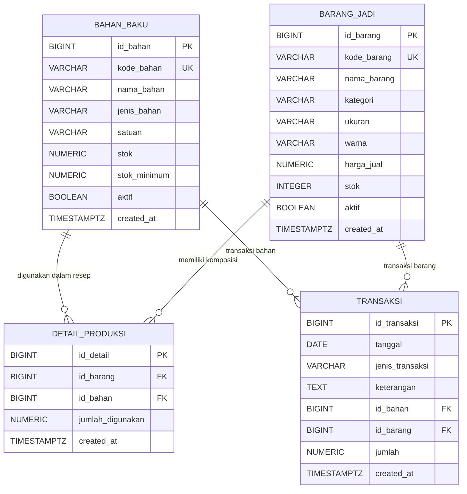

# Dokumentasi Skema Sistem Persediaan Toko Butik

## 1. Gambaran Umum

Basis data ini digunakan untuk mencatat persediaan bahan baku dan barang jadi butik. Skema dibuat untuk PostgreSQL dan digunakan bersama Supabase. Data dibagi menjadi empat tabel utama:

- `bahan_baku`: katalog dan saldo bahan baku.
- `barang_jadi`: katalog dan saldo produk butik.
- `detail_produksi`: resep atau komposisi bahan untuk menghasilkan barang jadi.
- `transaksi`: riwayat bahan masuk/keluar dan barang yang diproduksi/dijual.

Perubahan saldo akibat transaksi ditangani oleh trigger database. Dengan demikian, aplikasi mencatat pergerakan melalui `transaksi`, sedangkan database menerapkan perubahan stoknya.

## 2. Diagram ERD

### Cara membaca relasi

- **`barang_jadi` ke `detail_produksi`: satu-ke-banyak (1:N).** Satu barang jadi dapat memiliki beberapa baris resep, sedangkan setiap baris resep merujuk tepat ke satu barang jadi.
- **`bahan_baku` ke `detail_produksi`: satu-ke-banyak (1:N).** Satu bahan dapat digunakan pada resep banyak barang jadi, sedangkan setiap baris resep merujuk tepat ke satu bahan.
- Kedua relasi resep tersebut membentuk hubungan **banyak-ke-banyak (N:M)** antara barang jadi dan bahan baku. `detail_produksi` menjadi tabel penghubung sekaligus menyimpan jumlah bahan yang diperlukan. Kombinasi `(id_barang, id_bahan)` dibuat unik agar bahan yang sama tidak tercatat dua kali pada resep produk yang sama.
- **`bahan_baku` ke `transaksi`: satu-ke-banyak (1:N), secara kondisional.** Transaksi `MASUK` dan `BAHAN_KELUAR` harus merujuk ke bahan baku.
- **`barang_jadi` ke `transaksi`: satu-ke-banyak (1:N), secara kondisional.** Transaksi `PRODUKSI` dan `KELUAR` harus merujuk ke barang jadi.
- Setiap transaksi mengacu ke **tepat satu** target: bahan baku atau barang jadi. Constraint `transaksi_relasi_valid` memastikan kolom target yang tidak sesuai jenis transaksi bernilai `NULL`.

## 3. Rincian Tabel

### 3.1 `bahan_baku`

Menyimpan identitas, satuan, dan saldo bahan yang digunakan untuk produksi.

| Kolom | Tipe | Keterangan |
|---|---|---|
| `id_bahan` | `BIGINT` | Primary key dengan identity otomatis. |
| `kode_bahan` | `VARCHAR(20)` | Kode bahan yang wajib diisi dan unik. |
| `nama_bahan` | `VARCHAR(100)` | Nama bahan, wajib diisi. |
| `jenis_bahan` | `VARCHAR(50)` | Kategori atau jenis bahan; boleh kosong. |
| `satuan` | `VARCHAR(20)` | Satuan stok, wajib diisi, misalnya meter, roll, atau pcs. |
| `stok` | `NUMERIC(12,2)` | Saldo saat ini, default `0`, tidak boleh negatif. Mendukung pecahan. |
| `stok_minimum` | `NUMERIC(12,2)` | Ambang stok minimum, default `0`, tidak boleh negatif. |
| `aktif` | `BOOLEAN` | Status katalog, default `TRUE`. Bahan nonaktif tidak dapat dipakai untuk produksi. |
| `created_at` | `TIMESTAMPTZ` | Waktu pembuatan, default waktu database saat ini. |

### 3.2 `barang_jadi`

Menyimpan identitas produk, atribut penjualan, dan saldo barang jadi.

| Kolom | Tipe | Keterangan |
|---|---|---|
| `id_barang` | `BIGINT` | Primary key dengan identity otomatis. |
| `kode_barang` | `VARCHAR(20)` | Kode barang yang wajib diisi dan unik. |
| `nama_barang` | `VARCHAR(100)` | Nama barang, wajib diisi. |
| `kategori` | `VARCHAR(50)` | Kategori produk; boleh kosong. |
| `ukuran` | `VARCHAR(10)` | Ukuran produk; boleh kosong. |
| `warna` | `VARCHAR(30)` | Warna produk; boleh kosong. |
| `harga_jual` | `NUMERIC(15,2)` | Harga jual, default `0`, tidak boleh negatif. |
| `stok` | `INTEGER` | Saldo barang dalam unit utuh, default `0`, tidak boleh negatif. |
| `aktif` | `BOOLEAN` | Status katalog, default `TRUE`. |
| `created_at` | `TIMESTAMPTZ` | Waktu pembuatan, default waktu database saat ini. |

### 3.3 `detail_produksi`

Menyimpan komposisi resep: bahan yang dibutuhkan untuk membuat satu unit barang jadi.

| Kolom | Tipe | Keterangan |
|---|---|---|
| `id_detail` | `BIGINT` | Primary key dengan identity otomatis. |
| `id_barang` | `BIGINT` | Foreign key ke `barang_jadi.id_barang`, wajib diisi. |
| `id_bahan` | `BIGINT` | Foreign key ke `bahan_baku.id_bahan`, wajib diisi. |
| `jumlah_digunakan` | `NUMERIC(12,2)` | Kuantitas bahan per satu unit produk; wajib lebih besar dari `0`. |
| `created_at` | `TIMESTAMPTZ` | Waktu pembuatan, default waktu database saat ini. |

Pasangan `id_barang` dan `id_bahan` memiliki constraint unik. Penghapusan barang atau bahan terkait akan menghapus baris resepnya (`ON DELETE CASCADE`).

### 3.4 `transaksi`

Mencatat pergerakan persediaan. Nilai `jumlah` harus lebih besar dari `0`; arah perubahan ditentukan oleh `jenis_transaksi`, bukan oleh tanda jumlah.

| Kolom | Tipe | Keterangan |
|---|---|---|
| `id_transaksi` | `BIGINT` | Primary key dengan identity otomatis. |
| `tanggal` | `DATE` | Tanggal transaksi, default tanggal saat ini. |
| `jenis_transaksi` | `VARCHAR(20)` | Salah satu dari `MASUK`, `BAHAN_KELUAR`, `PRODUKSI`, atau `KELUAR`. |
| `keterangan` | `TEXT` | Catatan tambahan; boleh kosong. |
| `id_bahan` | `BIGINT` | Foreign key opsional ke `bahan_baku`; digunakan untuk `MASUK` dan `BAHAN_KELUAR`. |
| `id_barang` | `BIGINT` | Foreign key opsional ke `barang_jadi`; digunakan untuk `PRODUKSI` dan `KELUAR`. |
| `jumlah` | `NUMERIC(12,2)` | Kuantitas positif. Untuk produksi dan barang keluar harus bernilai bulat. |
| `created_at` | `TIMESTAMPTZ` | Waktu pencatatan, default waktu database saat ini. |

Foreign key transaksi menggunakan `ON DELETE RESTRICT`, sehingga bahan atau barang yang sudah memiliki riwayat transaksi tidak dapat dihapus.

## 4. Jenis Transaksi dan Dampaknya terhadap Stok

| Jenis | Target wajib | Dampak stok |
|---|---|---|
| `MASUK` | `id_bahan` | Menambah stok bahan baku sebesar `jumlah`. |
| `BAHAN_KELUAR` | `id_bahan` | Mengurangi stok bahan baku sebesar `jumlah`, jika stok mencukupi. Dipakai untuk pemakaian bahan di luar transaksi produksi. |
| `PRODUKSI` | `id_barang` | Mengurangi setiap bahan pada resep sesuai kuantitas resep dikali jumlah produksi, lalu menambah stok barang jadi. |
| `KELUAR` | `id_barang` | Mengurangi stok barang jadi sebesar `jumlah`, jika stok mencukupi; umumnya untuk barang terjual/keluar. |

### Contoh perhitungan produksi

Jika satu blouse membutuhkan `2` meter kain dan `1` roll benang, transaksi produksi sebanyak `3` blouse akan mengurangi stok kain sebanyak `6` meter dan benang sebanyak `3` roll, kemudian menambah stok blouse sebanyak `3` unit. Transaksi ditolak jika resep belum tersedia, resep memakai bahan nonaktif, atau salah satu stok bahan tidak mencukupi.

## 5. Otomatisasi dan Aturan Integritas

Trigger `trigger_proses_transaksi_stok` berjalan **setelah setiap baris baru** dimasukkan ke `transaksi`. Trigger memanggil fungsi `proses_transaksi_stok()` untuk menerapkan perubahan saldo.

Aturan penting yang diterapkan database:

- Stok bahan baku dan barang jadi tidak boleh negatif.
- Harga jual dan stok minimum tidak boleh negatif.
- Jumlah transaksi harus positif.
- Kuantitas bahan dalam resep harus positif.
- Jumlah produksi dan barang jadi keluar harus bilangan bulat, meskipun kolom transaksi bertipe `NUMERIC`.
- Produksi harus memiliki resep dan seluruh bahan resep harus aktif serta cukup stoknya.
- Bila validasi dalam trigger gagal, operasi transaksi dibatalkan oleh database, termasuk perubahan stok yang dilakukan dalam operasi tersebut.
- Tabel `detail_produksi` menghapus baris resep terkait jika induk barang atau bahan dihapus. Tabel `transaksi` mencegah penghapusan bahan/barang yang sudah dirujuk riwayat.

Trigger saat ini hanya dipasang pada `INSERT`. Mengubah atau menghapus baris transaksi secara langsung tidak menjalankan pembalikan atau penghitungan ulang stok. Koreksi transaksi perlu dilakukan melalui prosedur aplikasi yang menjaga konsistensi, atau mekanisme koreksi database yang dirancang khusus.

## 6. Indeks

Skema membuat indeks berikut untuk membantu pencarian dan penyaringan:

- `idx_bahan_nama` pada `bahan_baku.nama_bahan`.
- `idx_barang_nama` pada `barang_jadi.nama_barang`.
- `idx_transaksi_tanggal` pada `transaksi.tanggal`.
- `idx_transaksi_jenis` pada `transaksi.jenis_transaksi`.

## 7. Akses dan Keamanan

Row Level Security (RLS) diaktifkan untuk keempat tabel. Kebijakan yang disediakan adalah kebijakan demo: role `anon` dan `authenticated` mendapat akses baca/tulis luas pada bahan, barang, dan resep; keduanya dapat membaca serta menambahkan transaksi. Kebijakan transaksi tidak menyediakan `UPDATE` atau `DELETE`.

Konfigurasi tersebut sesuai untuk demo atau tugas, bukan batas akses produksi. Sebelum dipakai di lingkungan produksi, kebijakan perlu dibatasi berdasarkan identitas dan kewenangan pengguna melalui Supabase Auth serta aturan akses yang sesuai.

## 8. Data Contoh

SQL menyertakan contoh bahan: kain katun, kain denim, benang jahit, dan kancing; contoh barang: blouse katun, dress denim, dan rok katun. Tabel resep menghubungkan barang-barang tersebut dengan bahan serta kuantitas pemakaiannya.

Data contoh menggunakan `ON CONFLICT DO NOTHING`, sehingga kode yang sudah ada tidak ditambahkan ulang. Nilai stok pada contoh merupakan nilai awal katalog; perubahan berikutnya terjadi melalui transaksi.

## 9. Catatan Cakupan

Skema ini mencakup katalog, resep produksi, saldo persediaan, dan pencatatan pergerakan stok. Skema belum memiliki tabel pelanggan, pemasok, pengguna aplikasi khusus, detail penjualan per nota, pembayaran, maupun harga pokok produksi. Karena itu, `KELUAR` hanya mencatat pengurangan stok barang jadi dan belum menjadi sistem penjualan lengkap.

## 10. Berkas Sumber

Skema yang didokumentasikan tersedia pada:

- `backend/database.sql`
- `backend/database/database.sql`
