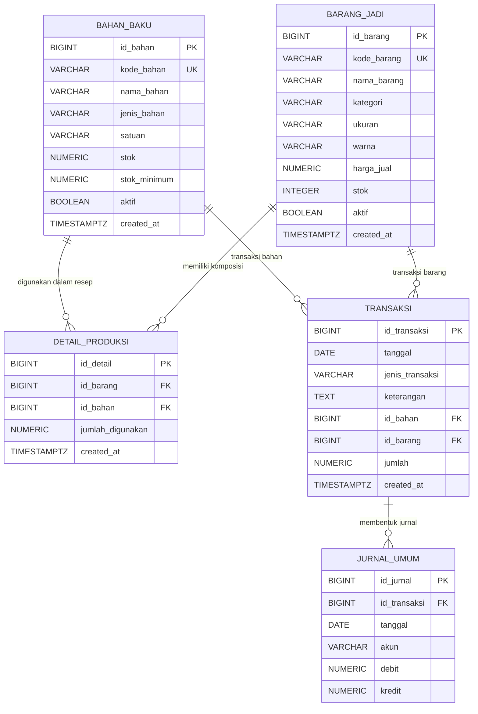

# Dokumentasi Skema Sistem Persediaan Toko Butik

## 1. Gambaran Umum

Basis data ini digunakan untuk mencatat persediaan bahan baku dan barang jadi butik. Skema dibuat untuk PostgreSQL dan digunakan bersama Supabase. Data utama dibagi menjadi lima tabel:

- `bahan_baku`: katalog dan saldo bahan baku.
- `barang_jadi`: katalog dan saldo produk butik.
- `detail_produksi`: resep atau komposisi bahan untuk menghasilkan barang jadi.
- `transaksi`: riwayat bahan masuk/keluar dan barang yang diproduksi/dijual.
- `jurnal_umum`: baris debit/kredit yang dibuat otomatis untuk setiap transaksi persediaan dan penjualan.

Perubahan saldo dan harga pokok rata-rata tertimbang ditangani oleh trigger database. Aplikasi mencatat kejadian melalui `transaksi`; database memperbarui stok, nilai persediaan, dan jurnal secara atomik.

## 2. Diagram ERD

### Cara membaca relasi

- **`barang_jadi` ke `detail_produksi`: satu-ke-banyak (1:N).** Satu barang jadi dapat memiliki beberapa baris resep, sedangkan setiap baris resep merujuk tepat ke satu barang jadi.
- **`bahan_baku` ke `detail_produksi`: satu-ke-banyak (1:N).** Satu bahan dapat digunakan pada resep banyak barang jadi, sedangkan setiap baris resep merujuk tepat ke satu bahan.
- Kedua relasi resep tersebut membentuk hubungan **banyak-ke-banyak (N:M)** antara barang jadi dan bahan baku. `detail_produksi` menjadi tabel penghubung sekaligus menyimpan jumlah bahan yang diperlukan. Kombinasi `(id_barang, id_bahan)` dibuat unik agar bahan yang sama tidak tercatat dua kali pada resep produk yang sama.
- **`bahan_baku` ke `transaksi`: satu-ke-banyak (1:N), secara kondisional.** Transaksi `MASUK` dan `BAHAN_KELUAR` harus merujuk ke bahan baku.
- **`barang_jadi` ke `transaksi`: satu-ke-banyak (1:N), secara kondisional.** Transaksi `PRODUKSI` dan `KELUAR` harus merujuk ke barang jadi.
- Setiap transaksi mengacu ke **tepat satu** target: bahan baku atau barang jadi. Constraint `transaksi_relasi_valid` memastikan kolom target yang tidak sesuai jenis transaksi bernilai `NULL`.

## 3. Rincian Tabel

### 3.1 `bahan_baku`

Menyimpan identitas, satuan, dan saldo bahan yang digunakan untuk produksi.

| Kolom | Tipe | Keterangan |
|---|---|---|
| `id_bahan` | `BIGINT` | Primary key dengan identity otomatis. |
| `kode_bahan` | `VARCHAR(20)` | Kode bahan yang wajib diisi dan unik. |
| `nama_bahan` | `VARCHAR(100)` | Nama bahan, wajib diisi. |
| `jenis_bahan` | `VARCHAR(50)` | Kategori atau jenis bahan; boleh kosong. |
| `satuan` | `VARCHAR(20)` | Satuan dasar stok, wajib diisi, misalnya meter atau pcs. Bahan yang dibeli per gulung tetapi dipakai per meter sebaiknya dicatat dalam meter setelah mengonversi isi gulung. |
| `stok` | `NUMERIC(12,2)` | Saldo saat ini, default `0`, tidak boleh negatif. Mendukung pecahan. |
| `stok_minimum` | `NUMERIC(12,2)` | Ambang notifikasi stok, default `1`; aplikasi memakai batas tetap `1`. |
| `harga_pokok_rata_rata` | `NUMERIC(15,4)` | Harga perolehan rata-rata bergerak per satuan bahan, digunakan menghitung biaya bahan dalam resep. |
| `aktif` | `BOOLEAN` | Status katalog, default `TRUE`. Bahan nonaktif tidak dapat dipakai untuk produksi. |
| `created_at` | `TIMESTAMPTZ` | Waktu pembuatan, default waktu database saat ini. |

### 3.2 `barang_jadi`

Menyimpan identitas produk, atribut penjualan, dan saldo barang jadi.

| Kolom | Tipe | Keterangan |
|---|---|---|
| `id_barang` | `BIGINT` | Primary key dengan identity otomatis. |
| `kode_barang` | `VARCHAR(20)` | Kode barang yang wajib diisi dan unik. |
| `nama_barang` | `VARCHAR(100)` | Nama barang, wajib diisi. |
| `kategori` | `VARCHAR(50)` | Kategori produk; boleh kosong. |
| `ukuran` | `VARCHAR(10)` | Ukuran produk; boleh kosong. |
| `warna` | `VARCHAR(30)` | Warna produk; boleh kosong. |
| `harga_jual` | `NUMERIC(15,2)` | Harga jual, default `0`, tidak boleh negatif. |
| `stok` | `INTEGER` | Saldo barang dalam unit utuh, default `0`, tidak boleh negatif. |
| `harga_pokok_rata_rata` | `NUMERIC(15,4)` | HPP rata-rata bergerak per unit untuk stok barang jadi yang sudah terbentuk. Nilai ini diperbarui ketika produksi, saldo awal, atau penilaian stok dicatat. |
| `aktif` | `BOOLEAN` | Status katalog, default `TRUE`. |
| `created_at` | `TIMESTAMPTZ` | Waktu pembuatan, default waktu database saat ini. |

### 3.3 `detail_produksi`

Menyimpan komposisi resep: bahan yang dibutuhkan untuk membuat satu unit barang jadi.

| Kolom | Tipe | Keterangan |
|---|---|---|
| `id_detail` | `BIGINT` | Primary key dengan identity otomatis. |
| `id_barang` | `BIGINT` | Foreign key ke `barang_jadi.id_barang`, wajib diisi. |
| `id_bahan` | `BIGINT` | Foreign key ke `bahan_baku.id_bahan`, wajib diisi. |
| `jumlah_digunakan` | `NUMERIC(12,2)` | Kuantitas bahan per satu unit produk; wajib lebih besar dari `0`. |
| `created_at` | `TIMESTAMPTZ` | Waktu pembuatan, default waktu database saat ini. |

Pasangan `id_barang` dan `id_bahan` memiliki constraint unik. Penghapusan barang atau bahan terkait akan menghapus baris resepnya (`ON DELETE CASCADE`).

### 3.4 `transaksi`

Mencatat pergerakan persediaan. Nilai `jumlah` harus lebih besar dari `0`; arah perubahan ditentukan oleh `jenis_transaksi`, bukan oleh tanda jumlah.

| Kolom | Tipe | Keterangan |
|---|---|---|
| `id_transaksi` | `BIGINT` | Primary key dengan identity otomatis. |
| `tanggal` | `DATE` | Tanggal transaksi, default tanggal saat ini. |
| `jenis_transaksi` | `VARCHAR(20)` | Salah satu dari `MASUK`, `BAHAN_KELUAR`, `PRODUKSI`, atau `KELUAR`. |
| `keterangan` | `TEXT` | Catatan tambahan; boleh kosong. |
| `id_bahan` | `BIGINT` | Foreign key opsional ke `bahan_baku`; digunakan untuk `MASUK` dan `BAHAN_KELUAR`. |
| `id_barang` | `BIGINT` | Foreign key opsional ke `barang_jadi`; digunakan untuk `PRODUKSI` dan `KELUAR`. |
| `jumlah` | `NUMERIC(12,2)` | Kuantitas positif. Untuk produksi dan barang keluar harus bernilai bulat. |
| `harga_perolehan_satuan` | `NUMERIC(15,2)` | Harga beli per satuan, atau biaya per unit untuk saldo awal/penilaian stok. |
| `harga_jual_satuan` | `NUMERIC(15,2)` | Harga jual per unit untuk transaksi penjualan langsung. |
| `nilai_bahan` | `NUMERIC(15,2)` | Nilai bahan baku yang dikonsumsi untuk produksi. |
| `nilai_persediaan` | `NUMERIC(15,2)` | Nilai biaya stok atau barang jadi yang bergerak pada transaksi. |
| `nilai_penjualan` | `NUMERIC(15,2)` | Total penerimaan penjualan tunai/non-tunai. |
| `biaya_produksi` | `NUMERIC(15,2)` | Kolom kompatibilitas database lama; aplikasi butik tidak mengisi biaya tambahan produksi. |
| `metode_pembayaran` | `VARCHAR(20)` | Metode pembayaran langsung: tunai, transfer, QRIS, atau debit. |
| `created_at` | `TIMESTAMPTZ` | Waktu pencatatan, default waktu database saat ini. |

Foreign key transaksi menggunakan `ON DELETE RESTRICT`, sehingga bahan atau barang yang sudah memiliki riwayat transaksi tidak dapat dihapus.

## 4. Jenis Transaksi dan Dampaknya terhadap Stok

| Jenis | Target wajib | Dampak stok |
|---|---|---|
| `SALDO_AWAL` | Salah satu dari `id_bahan` / `id_barang` | Menambah kuantitas saldo awal dan mencatat debit Persediaan, kredit Modal Pemilik. |
| `PENILAIAN_AWAL` | Salah satu dari `id_bahan` / `id_barang` | Menetapkan harga pokok unit untuk stok lama tanpa mengubah kuantitas; jumlah wajib sama dengan stok aktual. |
| `MASUK` | `id_bahan` | Pembelian bahan tunai/non-tunai: menambah kuantitas dan nilai bahan dengan harga perolehan. |
| `BAHAN_KELUAR` | `id_bahan` | Mengurangi bahan untuk pemakaian di luar produksi dan mencatat beban bahan. |
| `PRODUKSI` | `id_barang` | Mengurangi bahan sesuai resep dan menambah barang jadi sebesar nilai bahan dalam resep. |
| `KELUAR` | `id_barang` | Penjualan langsung dibayar: mengurangi stok, mencatat kas/bank dan pendapatan serta HPP. |

## 5. Alur Akuntansi dan Metode Penilaian

Alur operasional yang saling terhubung:

1. Daftarkan bahan baku dan barang jadi, lalu tentukan bahan habis pakai serta jumlah pemakaian per unit satu kali pada menu **Bahan Habis Pakai**. HPP per unit dihitung otomatis dan tampil di daftar barang jadi.
2. Masukkan saldo awal yang sudah ada beserta harga perolehan. Untuk data stok lama yang sudah tersimpan tanpa nilai, catat `PENILAIAN_AWAL` satu kali berdasarkan jumlah stok saat ini dan biaya perolehan yang dapat didukung dokumen.
3. Catat pembelian bahan pada `MASUK`, termasuk harga per satuan dan metode pembayaran (`TUNAI`, `TRANSFER`, `QRIS`, atau `DEBIT`).
4. Catat `PRODUKSI`: bahan berkurang sesuai resep dan nilai bahan tersebut menjadi harga pokok barang jadi. Upah jahit tidak dicatat terpisah di transaksi produksi; harga jual barang jadi ditetapkan dengan mempertimbangkan biaya butik.
5. Catat `KELUAR` untuk penjualan yang dibayar langsung. Sistem mencatat penerimaan kas/bank, pendapatan penjualan, HPP, serta pengurangan persediaan.
6. Pilih menu **Laporan Akuntansi** untuk melihat penjualan, HPP, laba kotor, pembelian, nilai persediaan saat ini, serta jurnal umum.

Persediaan memakai metode **rata-rata tertimbang bergerak**. Pembelian mencampur harga perolehan baru dengan nilai stok lama; produksi memindahkan nilai bahan menjadi barang jadi. Harga jual tidak dipakai untuk menilai persediaan.

HPP barang jadi tidak dimasukkan sebagai transaksi HPP terpisah. Sistem menghitung HPP per unit dari jumlah bahan habis pakai dalam komposisi produksi dikalikan harga pokok rata-rata bahan. Produk baru disimpan tanpa stok, lalu komposisi ditambahkan satu kali melalui menu **Bahan Habis Pakai**; HPP per unit otomatis ditampilkan di daftar barang jadi dan daftar bahan digunakan kembali setiap produksi dicatat. Saldo awal bahan atau produk dicatat melalui menu **Transaksi**, bukan formulir master data, supaya pembaruan stok dan jurnal selalu melalui alur yang sama. Kode bahan dan produk dibuat otomatis oleh aplikasi. Upah jahit tidak dicatat terpisah dalam aplikasi sesuai kebijakan butik; harga jual barang jadi ditetapkan oleh butik dengan mempertimbangkan biaya tersebut. Saat transaksi `PRODUKSI` disimpan, nilai bahan habis pakai dipindahkan ke persediaan barang jadi dan memperbarui HPP rata-rata bergerak. Ketika `KELUAR` dicatat, HPP penjualan dihitung dari HPP rata-rata barang jadi saat itu. Daftar produk membedakan HPP rata-rata stok dari biaya bahan per unit. Riwayat yang dibuat sebelum kolom nilai dan jurnal tersedia tidak bisa memperoleh HPP historis secara otomatis dan perlu dinilai berdasarkan dokumen yang tersedia.

Jurnal otomatis:

| Peristiwa | Debit | Kredit |
|---|---|---|
| Saldo awal | Persediaan bahan/barang jadi | Modal Pemilik |
| Pembelian bahan langsung dibayar | Persediaan Bahan Baku | Kas atau Bank |
| Bahan keluar di luar produksi | Beban Bahan Baku | Persediaan Bahan Baku |
| Produksi | Persediaan Barang Jadi | Persediaan Bahan Baku dan Kas/Bank untuk biaya tambahan |
| Penjualan langsung dibayar | Kas/Bank dan Harga Pokok Penjualan | Penjualan dan Persediaan Barang Jadi |

### Contoh perhitungan produksi

Jika satu blouse membutuhkan `2` meter kain dan `5` meter benang, transaksi produksi sebanyak `3` blouse akan mengurangi stok kain sebanyak `6` meter dan benang sebanyak `15` meter, kemudian menambah stok blouse sebanyak `3` unit. Bila benang dibeli per gulung berisi `100` meter, catat harga per meter dengan membagi harga gulung dengan `100`. Transaksi ditolak jika resep belum tersedia, resep memakai bahan nonaktif, atau salah satu stok bahan tidak mencukupi.

## 6. Otomatisasi dan Aturan Integritas

Trigger `trigger_proses_transaksi_stok` berjalan **sebelum penyimpanan transaksi** untuk menghitung biaya dan mengubah stok dalam transaksi database yang sama. Trigger `trigger_catat_jurnal_transaksi` lalu membuat baris debit/kredit. Jika validasi atau jurnal gagal, keseluruhan transaksi dan perubahan stok dibatalkan.

Aturan penting yang diterapkan database:

- Stok bahan baku dan barang jadi tidak boleh negatif.
- Harga jual dan stok minimum tidak boleh negatif.
- Jumlah transaksi harus positif.
- Kuantitas bahan dalam resep harus positif.
- Jumlah produksi dan barang jadi keluar harus bilangan bulat, meskipun kolom transaksi bertipe `NUMERIC`.
- Produksi harus memiliki resep dan seluruh bahan resep harus aktif serta cukup stoknya.
- Pembelian dan penjualan harus menyertakan harga per satuan serta metode pembayaran langsung.
- Penjualan/produksi tidak dapat menggunakan saldo lama yang belum dinilai.
- Jurnal dibuat oleh trigger dan hanya dapat dibaca melalui aplikasi; jangan mengubah jurnal transaksi secara manual.
- Bila validasi dalam trigger gagal, operasi transaksi dibatalkan oleh database, termasuk perubahan stok yang dilakukan dalam operasi tersebut.
- Tabel `detail_produksi` menghapus baris resep terkait jika induk barang atau bahan dihapus. Tabel `transaksi` mencegah penghapusan bahan/barang yang sudah dirujuk riwayat.

Trigger saat ini hanya dipasang pada `INSERT`. Mengubah atau menghapus baris transaksi secara langsung tidak menjalankan pembalikan atau penghitungan ulang stok. Koreksi transaksi perlu dilakukan melalui prosedur aplikasi yang menjaga konsistensi, atau mekanisme koreksi database yang dirancang khusus.

## 7. Indeks

Skema membuat indeks berikut untuk membantu pencarian dan penyaringan:

- `idx_bahan_nama` pada `bahan_baku.nama_bahan`.
- `idx_barang_nama` pada `barang_jadi.nama_barang`.
- `idx_transaksi_tanggal` pada `transaksi.tanggal`.
- `idx_transaksi_jenis` pada `transaksi.jenis_transaksi`.
- `idx_jurnal_tanggal` dan `idx_jurnal_transaksi` pada `jurnal_umum`.

## 8. Akses dan Keamanan

Row Level Security (RLS) diaktifkan untuk kelima tabel. Hanya role `authenticated` yang diberi akses baca/tulis sesuai kebutuhan; role `anon` tidak memiliki grant atau kebijakan untuk tabel. Semua akun yang berhasil login memiliki akses bersama ke data butik, bukan pemisahan data per pengguna.

Autentikasi menggunakan Supabase Auth email/kata sandi. Buat akun pemilik dan pegawai secara manual melalui **Supabase Dashboard → Authentication → Users** dan nonaktifkan pendaftaran publik di pengaturan Authentication. Jangan membagikan `service_role` key ke frontend; frontend hanya menggunakan publishable/anon key, yang dibatasi oleh grant dan kebijakan RLS.

Setelah mengubah kebijakan pada database yang sudah ada, jalankan kembali bagian **ROW LEVEL SECURITY** dari `backend/database.sql` atau `backend/database/database.sql` melalui Supabase SQL Editor. Menyembunyikan tampilan aplikasi tanpa menerapkan kebijakan RLS tidak cukup untuk melindungi data.

## 9. Data Contoh

SQL menyertakan contoh bahan: kain katun, kain denim, benang jahit, dan kancing; contoh barang: blouse katun, dress denim, dan rok katun. Tabel resep menghubungkan barang-barang tersebut dengan bahan serta kuantitas pemakaiannya.

Data contoh menggunakan `ON CONFLICT DO NOTHING`, sehingga kode yang sudah ada tidak ditambahkan ulang. Data contoh yang telah ada sebelum migrasi dapat memiliki stok tetapi belum memiliki harga pokok atau jurnal; gunakan **Penilaian Stok Lama** dan jangan anggap laporan historis sebelum migrasi lengkap.

## 10. Cakupan dan Batasan

Skema ini mendukung persediaan bahan/barang jadi, resep produksi, penjualan langsung tunai/non-tunai, HPP rata-rata tertimbang, jurnal umum, dan ringkasan laba kotor. Piutang pelanggan tidak digunakan. Aplikasi belum merupakan sistem akuntansi penuh: belum ada retur, pajak, utang pemasok, biaya operasional umum, buku besar neraca/laba rugi lengkap, atau nomor nota dan rincian multi-item dalam satu nota. Koreksi transaksi yang sudah tersimpan perlu prosedur khusus karena perubahan/penghapusan transaksi tidak membalik stok atau jurnal secara otomatis.

## 11. Berkas Sumber

Skema yang didokumentasikan tersedia pada:

- `backend/database.sql`
- `backend/database/database.sql`
